# Kairos

[](LICENSE)


*TradingAgents, but the market is real.*

A from-scratch, low-latency **C++20** matching engine for market
microstructure research — deterministic, integer ticks/lots, no randomness
in the core — with one-command tournaments, honest fill modeling, and a
public bot leaderboard.

```bash
pip install kairos-hft
kairos demo
```

Two minutes later you have a ranked 10-seed tournament in your terminal.



## Table of contents

- [Why Kairos exists](#why-kairos-exists)
- [Features](#features)
- [Install](#install)
- [Quickstart](#quickstart)
- [The realism-gap finding](#the-realism-gap-finding)
- [Leaderboard & seasons](#leaderboard--seasons)
- [Write your own bot](#write-your-own-bot)
- [Testing](#testing)
- [Benchmarks](#benchmarks)
- [Project layout](#project-layout)
- [Documentation](#documentation)
- [Roadmap](#roadmap)
- [Limitations](#limitations)
- [Contributing](#contributing)
- [License](#license)

## Why Kairos exists

Most open-source backtesters assume you get filled at the price you see.
That assumption is wrong, and the error compounds. Kairos models order-entry
latency and queue position — and then **measures** the gap: on synthetic
data, naive fill-at-touch overstates market-maker PnL by **~19%** versus a
realistic queue model ([research note](docs/research/realism-gap.md)).

Validation, not features, is the differentiator.

**v1.0 at a glance:** one command to a real tournament (`kairos demo`) ·
92/92 C++ tests green, ASan/UBSan clean, Python suite green · ~19% measured
naive-fill PnL overstatement · deterministic — same seed, identical fills ·
public bot leaderboard with Season 1 recorded.

## Features

- **Deterministic matching engine** — price-time priority; limit, market,
  IOC, FOK, post-only; modify/cancel; self-trade policies. Allocation-free
  event output, fixed-capacity structures, no locks or exceptions in the hot
  path. Differential-tested against a naive reference (~18M adversarial ops,
  ASan/UBSan clean).
- **Two modes, one core** — a **backtester** (replays recorded L2 data with
  realistic entry latency and queue-position modelling) and an **arena**
  (simulated agents drive the same engine in logical time).
- **Realistic fill modelling** — constant, jittered, and empirical latency
  models; naive, risk-averse, and probabilistic queue-position models;
  simulated account with fees and PnL.
- **Event-driven Strategy API** — compile-time dispatch, no virtual calls;
  the same strategy code runs in the backtester and the arena. C++ and
  Python (pybind11) strategies with bit-identical A-S quotes.
- **Avellaneda–Stoikov market maker** — reference implementation (C++ +
  Python) with tested sigma/kappa estimators.
- **Tournament arena** — deterministic flow generators (noise, informed,
  background makers, momentum) and 5 example bots (A-S, fixed-spread,
  momentum, random, cheater) compete under identical latency, information,
  fees, and seeds. PnL / inventory-penalty / risk-adjusted scoring; position,
  rate-limit, and callback time-budget anti-cheat; static HTML leaderboard.
- **Public leaderboard & seasons** — versioned season configs, append-only
  results ledger committed to the repo, so anyone can re-run a season and
  verify a score.
- **LLM agent framework** — `kairos.agents` with an `ArenaBot` base,
  stdlib-only LLM client, deterministic `MockLLM`, and a `DebateTrader`
  reference agent (analyst → bull/bear debate → trader → rule-based risk
  gate). Logical-time markets mean LLM thinking time buys no advantage.
- **Claude Code skill** — ships
  [`.claude/skills/kairos/SKILL.md`](.claude/skills/kairos/SKILL.md):
  "build and backtest a market-making bot on a real matching engine." Every
  command in it was validated end-to-end.
- **Market-data capture & replay** — Coinbase L2 recorder (websocket with
  REST fallback, no API key needed), fixed-size mmap-able binary format with
  CRC32, deterministic C++ replay at ~1M events/sec.

## Install

**Prerequisites:** Python ≥ 3.10. (From source: also CMake ≥ 3.24 and a C++20
compiler — GCC or Clang.)

**Option A — pip (fastest):**

```bash
pip install kairos-hft
kairos demo
```

> The PyPI release is pending — until then, install the v1.0 wheel from the
> [GitHub release](https://github.com/anshlakhera048/Kairos/releases)
> (CPython 3.12, Linux x86_64):
> ```bash
> pip install kairos_hft-1.0.0-cp312-cp312-linux_x86_64.whl
> ```

**Option B — from source** (contributor path; all work happens on the `dev`
branch, `main` is kept clean):

```bash
git clone -b dev https://github.com/anshlakhera048/Kairos.git
cd Kairos
./scripts/build.sh            # debug build
ctest --preset debug          # all tests
```

First configure downloads GoogleTest, Google Benchmark, and pybind11 via
FetchContent (internet needed once).

## Quickstart

**Run a tournament:**

```bash
kairos demo
# Kairos Arena — 10 seeds x 30s · regime=calm · deterministic C++ engine
#   #  bot           score  mean PnL($)    fills  seeds  dq
#   1  fixed          0.92         0.31       18     10   0
#   2  as             0.92         0.31       18     10   0
#   3  momentum      -0.00         0.00        2     10   0

kairos arena --help   # full options: bots, seeds, regimes, JSON/HTML output
```

**Run your own Python bot** (including LLM agents) on the same engine:

```python
# mybot.py
from kairos.agents import ArenaBot

class MyBot(ArenaBot):
    def on_timer(self, ctx):
        bid, ask = ctx.best_bid(), ctx.best_ask()
        if bid and ask:
            mid = (bid[0] + ask[0]) // 2
            ctx.send_limit("bid", mid - 2, 100_000, post_only=True)
            ctx.send_limit("ask", mid + 2, 100_000, post_only=True)
```

```bash
kairos arena --bots as --py-bot mybot.py:MyBot --seeds 5 --duration 60
```

Python bots compete on identical seeds and markets as the C++ bots.

**Run the LLM reference agent** (works offline with a mock LLM, or live
with any OpenAI-compatible endpoint):

```bash
# offline — no API key needed
python3 examples/debate_demo.py

# live
export KAIROS_LLM_API_BASE="https://openrouter.ai/api/v1"
export KAIROS_LLM_API_KEY="..."
export KAIROS_LLM_MODEL="anthropic/claude-haiku-4-5"
kairos arena --bots none --py-bot debate_demo.py:make_debate --seeds 3 \
  --duration 120 --budget-s 300
```

`--budget-s` only guards against hangs — thinking time buys no edge, because
the market runs in logical time. See [docs/adr/0005-arena-python-bindings.md](docs/adr/0005-arena-python-bindings.md) for the design.

**Reproduce the headline finding** (no build needed):

```bash
kairos realism-gap --chart gap.svg
```

Same strategy, same data, four fill-honesty levels (naive / +latency /
+risk-averse queue / +probabilistic queue) — printed as a comparison table
with the overstatement % and an SVG equity-curve chart. Or regenerate every
figure in the research note from source: `./scripts/realism_gap.sh
./docs/research/figures`.

## The realism-gap finding

`kairos realism-gap` runs one A-S market-making strategy on one fixed-seed
synthetic capture under four fill models and reports how much each
flatters the PnL:

| Fill model | Mean PnL vs realistic |
|---|---|
| Naive (fill at touch) | **+~19% overstated** |
| + entry latency | narrows the gap |
| + risk-averse queue position | narrows further |
| + probabilistic queue position | baseline (honest) |

Full experiment, methodology, and figures:
[docs/research/realism-gap.md](docs/research/realism-gap.md).

## Leaderboard & seasons

Published bot competitions. A season is a fixed, versioned config
(`data/seasons/`); official results are committed to the repo ledger
(`data/leaderboard/ledger.jsonl`), so anyone can re-run a season and verify
a score.

```bash
kairos season list                        # published seasons
kairos season run season-01               # run it, record it
kairos leaderboard --season season-01     # ranked table
kairos leaderboard --season season-01 --html board.html
```

**Season 1 — Genesis** (inaugural, maintainer-run): 20 seeds × 30s, calm
regime, built-in bots. `fixed` edged out `as` by 0.0001 — the A-S bot's
single disqualified seed cost it the title.

| Rank | Bot | Score | Mean PnL | Fills | Seeds | DQ |
| ---- | --- | ----- | -------- | ----- | ----- | -- |
| 1 | fixed | 0.7886 | $0.29 | 32 | 20 | 0 |
| 2 | as | 0.7885 | $0.29 | 32 | 20 | 1 |
| 3 | momentum | -0.0020 | $0.00 | 6 | 20 | 1 |

Score = mean PnL − inventory penalty + Sharpe-like term.

## Write your own bot

A bot is any class satisfying the Strategy concept — seven callbacks, no
inheritance required. It works unchanged in the backtester and the arena:

```cpp
#include "strategies/arena_bots.hpp"  // example bots to crib from

class MyBot {
public:
    template <typename Ctx>
    void on_book_update(Ctx& ctx) {
        // ctx.book()      -> delayed L2 view (no lookahead, ever)
        // ctx.account()   -> your positions and PnL
        // ctx.send_limit(side, price_ticks, qty_lots, post_only) -> order id
        // ctx.cancel(order_id)
        // ctx.now()       -> your logical timestamp (ns)
    }
    template <typename Ctx> void on_trade(Ctx&, const TradeInfo&) {}
    template <typename Ctx> void on_own_fill(Ctx& ctx, const SimFill&) {}
    template <typename Ctx> void on_ack(Ctx&, const AckInfo&) {}
    template <typename Ctx> void on_reject(Ctx&, std::uint64_t) {}
    template <typename Ctx> void on_cancel(Ctx&, std::uint64_t) {}
    template <typename Ctx> void on_timer(Ctx& ctx) {}
};
```

Two rules that will save you an afternoon:

- **Gate your requotes.** The arena delivers a book view on nearly every
  event-loop tick. Cancel/re-place only when your desired quotes actually
  change, or you will hammer the order-rate limiter (the A-S bot learned this
  the hard way — 8.9M rejections before gating).
- **Mind your units.** The engine tracks positions in micro-lots
  (`qty_scale = 1e6`); the A-S model takes inventory in whole lots. Convert,
  or one fill will throw your quotes 400k ticks off-touch.

Then register it in `tools/arena/run_tournament.cpp` and compete.
**Python bots:** subclass `kairos.agents.ArenaBot` and run
`kairos arena --py-bot mybot.py:MyBot` — see `examples/debate_demo.py`.

## Testing

Every claim in this README is reproducible from the repo. The bar for any
change: `./scripts/sanitizers.sh` clean, `ctest` green, both compilers.

```bash
# C++: 92 tests — unit, differential (vs a naive reference engine),
# randomized, and replay. Two skip without optional data files
# (live capture / synthetic capture); everything else must pass.
./scripts/build.sh
ctest --preset debug            # 100% passed, 0 failed

# sanitizers — required clean on every change
./scripts/sanitizers.sh         # ASan + UBSan over the full suite

# Python: bindings parity, agents, realism determinism, seasons ledger
cmake --build --preset debug --target kairos_py
PYTHONPATH=python python3 python/test_agents.py
PYTHONPATH=python python3 python/test_realism.py
PYTHONPATH=python python3 python/test_seasons.py
PYTHONPATH=python python3 python/test_bindings.py <capture.kai>

# differential soak: ~18M adversarial ops vs the naive reference
./scripts/diff_soak.sh
```

## Benchmarks

Methodology first, numbers second — read
[docs/benchmarks/METHODOLOGY.md](docs/benchmarks/METHODOLOGY.md) before
trusting any number. Benchmarks run on pinned, isolated hardware via
`./scripts/bench.sh` — never in CI, never on shared runners. Python
callbacks are ~11.6× slower than C++ strategies
([details](docs/python-overhead.md)) — measure before you trade on it.

## Project layout

```
include/kairos/   public headers: types, order book, engine, events, models
src/              implementation
strategies/       example bots (arena) + A-S market maker
tests/            unit / differential / randomized tests
bench/            Google Benchmark + custom latency harness
tools/            recorder, replay, realism-gap experiment, tournament
python/           pybind11 bindings + Python strategies + agent framework
docs/             design notes, ADRs, benchmarks, research, LEARNING.md
scripts/          build, format, bench, sanitizer, experiment helpers
data/             season configs + append-only leaderboard ledger
examples/         debate_demo.py and other runnable examples
```

## Documentation

- [docs/design/](docs/design/) — order book, matching, fill model, arena,
  data format, validation plan, hosting threat model.
- [docs/adr/](docs/adr/) — architecture decision records (why the core looks
  the way it does).
- [docs/benchmarks/](docs/benchmarks/) — methodology first, numbers second.
- [docs/research/realism-gap.md](docs/research/realism-gap.md) — the
  experiment and what it found.
- [docs/releases/v1.0.md](docs/releases/v1.0.md) — v1.0 release notes.
- [docs/LEARNING.md](docs/LEARNING.md) — concepts behind the code, in plain
  language. Start here if you're new to market microstructure.
- [AGENTS.md](AGENTS.md) — engineering rules for working in this codebase
  (human or agent). Read before contributing.

## Roadmap

| Phase | What | Status |
|---|---|---|
| 1 | Matching engine | Done — 92 tests, ASan/UBSan clean, differential-tested |
| 2 | Capture, replay, fill modelling | Done |
| 3 | Strategy API, A-S market maker, Python bindings | Done |
| 4 | Tournament arena + leaderboard | Done — 5 bots × 50 seeds reproducible |
| 5 | pip packaging (`kairos-hft`) + `kairos` CLI | Done — `kairos demo` in two minutes |
| 6 | Arena Python bindings + LLM agent framework | Done — `kairos arena --py-bot`, `DebateTrader` |
| 7 | One-command realism-gap demo | Done — `kairos realism-gap` (table + SVG chart) |
| 8 | Public leaderboard + season 1 | Done — `kairos season run`, Season 1 recorded |
| 9 | SKILL.md for Claude Code | Done — validated end-to-end |
| 10 | v1.0 launch prep | Done — hook line, terminal cast, release notes, 1.0.0 |

**What's next:** validation of the fill model against real fills
([plan](docs/design/validation-plan.md)); PyPI publication of
`kairos-hft`; Season 2 with community-submitted bots.

## Limitations

- **No live trading.** Nothing here connects to an exchange for order
  placement, and that is deliberate. The recorder is read-only market data.
- **Synthetic-first validation.** The realism-gap results are measured on
  synthetic captures; validation against real fills is planned, not done.
- **Single-threaded, single-machine.** The engine and arena are deterministic
  and single-threaded by design. There is no distributed deployment story.
- **Benchmarks are indicative.** Latency numbers were measured on specific
  hardware; re-run on your own machine with `./scripts/bench.sh`.
- **Python is for research, not production quoting** (~11.6× overhead vs
  C++).
- **CI is not yet live.** Until a workflow runs green, `./scripts/sanitizers.sh`
  + `ctest` are the bar.

## Contributing

Contributions are welcome — bug reports, calibration data, new example bots,
and documentation improvements especially. Please read
[CONTRIBUTING.md](CONTRIBUTING.md) and [AGENTS.md](AGENTS.md) first; the
engineering rules (no heap allocation in the hot path, strict warnings as
errors, sanitizers clean on every change) are non-negotiable and enforced in
review. Bug fixes ship with a regression test that fails before and passes
after.

## License

MIT — see [LICENSE](LICENSE).
